# PropPage — Agent User Manual (Tanglish)

Indha manual Tamil Nadu-la irukkura property agents, brokers-ukkaaga. Phone-la PropPage eppadi use pannanum nu step by step sollirukkom.

- Button, screen per ellaam app-la irukkura maadhiriye English-la, quotes-kulla kuduthirukkom. Udhaaranam: **"Add"**, **"Publish listing"**.
- Screenshot ellaam phone size-la eduthadhu. Demo agent: Senthil Kumar, Sri Velan Properties, Coimbatore.
- Admin-ukkaana guide thaniya irukku: [admin-guide.md](admin-guide.md).

## Ulla enna irukku

1. [PropPage-na enna?](#1-proppage-na-enna)
2. [Signup, sign in, phone-la install](#2-signup-sign-in-phone-la-install)
3. [Overview — mudhal screen](#3-overview--mudhal-screen)
4. [Keezha irukkura menu, Language, Help](#4-keezha-irukkura-menu-language-help)
5. [Property add pannradhu](#5-property-add-pannradhu)
6. [My properties — unga listings](#6-my-properties--unga-listings)
7. [Title documents](#7-title-documents)
8. [Buyers unga page-la enna paarpaanga](#8-buyers-unga-page-la-enna-paarpaanga)
9. [Enquiries — yaar kettaanga, follow-up](#9-enquiries--yaar-kettaanga-follow-up)
10. [Buyers — client enna thedraanga](#10-buyers--client-enna-thedraanga)
11. [Stats](#11-stats)
12. [Share my page — link, poster, visiting card](#12-share-my-page--link-poster-visiting-card)
13. [Profile & branding](#13-profile--branding)
14. [Plan & billing — UPI-la pay pannradhu](#14-plan--billing--upi-la-pay-pannradhu)
15. [Account & data](#15-account--data)
16. [Ungalukku varra emails, help](#16-ungalukku-varra-emails-help)
17. [FAQ — adikkadi kekkura kelvigal](#17-faq--adikkadi-kekkura-kelvigal)

---

## 1. PropPage-na enna?

PropPage unga sondha property website maadhiri. Unga ellaa property-um **oru link-la** irukkum.

- Plot, veedu, flat, rent, lease — ellaathayum oru dhadava add pannunga.
- Unga link-a WhatsApp-la client-ukku anuppunga. Photo, price, location ellaam avanga paappaanga.
- Client page-la irundhe ungalukku **WhatsApp**, **Call** pannuvaanga, illa enquiry form fill pannuvaanga.
- Enquiry ellaam **"Enquiries"** screen-la varum. Follow-up date, site visit ellaam angeye note pannalaam.
- Owner number, survey number, documents — ivai ellaam **ungalukku mattum** theriyum. Buyer-ku theriyaadhu.

Udhaaranam: Senthil-oda link `…/a/senthil-coimbatore`. Idha mattum anuppinaa podhum, ellaa property-um client paappaar.

---

## 2. Signup, sign in, phone-la install

### 2.1 Free trial start pannunga

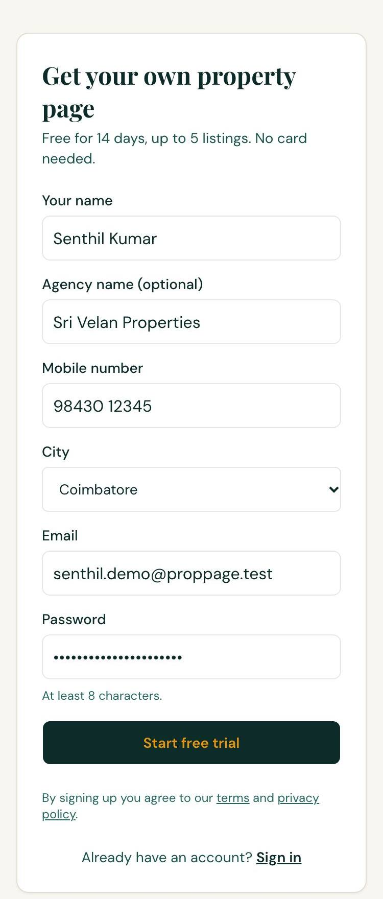

**14 naal free trial.** 5 listings varaikkum podalaam. Card edhuvum thevai illa.

1. Browser-la PropPage website open pannunga. **"Start free trial"** tap pannunga (illa `/register` page).
2. **"Your name"** — unga peyar.
3. **"Agency name (optional)"** — unga office / company peyar. Illana kaali-ya vidunga.
4. **"Mobile number"** — 10 digit mobile number.
5. **"City"** — unga ooru.
6. **"Email"** — unga email. Confirm link inga dhaan varum.
7. **"Password"** — kuraindhadhu 8 letters.
8. **"Start free trial"** tap pannunga.

> **Gavanikka:** Oru mobile number-ku **oru free trial** dhaan. Account delete panni thirumba signup pannaalum, adhe number-ku trial thirumba varaadhu.

 

### 2.2 Email confirm pannunga

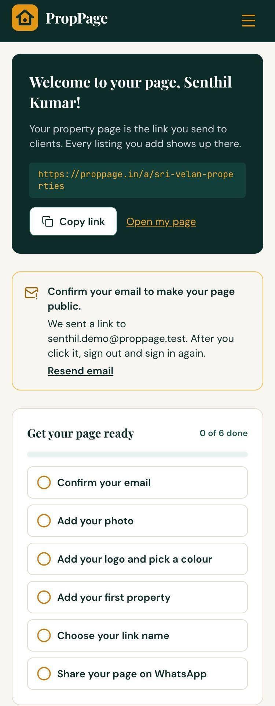

Signup aanadhum mudhal screen-la manjal box varum: **"Confirm your email to make your page public."**

1. Unga email inbox open pannunga (spam folder-um paarunga).
2. PropPage anuppuna link-a click pannunga. Adhu ungala thirumba PropPage dashboard-ku kootittu varum.
3. PropPage-ku thirumba vandhaa, page thaane kandupidikkum: manjal box maranjidum, **"Confirm your email"** step-la green tick varum. Sign out panna thevai illa.
4. Box innum irundhaa **"I've confirmed my email"** tap pannunga.
5. Ippo unga page ellaarukkum theriyum.

Email varala-na, adhe box-la **"Resend email"** tap pannunga.

> Email confirm pannra varaikkum unga page buyers-ku **paused**-a dhaan kaattum.

 

### 2.3 Sign in pannradhu

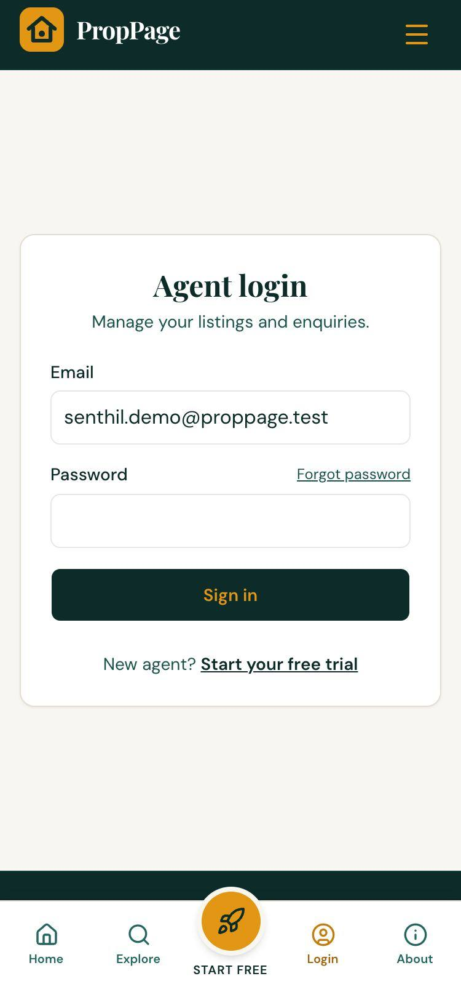

1. Website-la **"Agent login"** illa **"Login"** tap pannunga (`/login` page).
2. **"Email"**, **"Password"** type pannunga.
3. **"Sign in"** tap pannunga.

**Password marandhuteenga-na:**

1. **"Email"** box-la unga email type pannunga.
2. **"Forgot password"** tap pannunga.
3. Email-la varra link-la pudhu password podunga.

 

### 2.4 Phone-la app maadhiri vaikka

Home screen-la PropPage icon irundhaa, daily open panna easy.

**Android (Chrome):**

1. Chrome-la PropPage open pannunga, sign in pannunga.
2. Mela right side **⋮** (moonu pulli) tap pannunga.
3. **"Add to Home screen"** illa **"Install app"** tap pannunga.

**iPhone (Safari):**

1. Safari-la PropPage open pannunga.
2. Keezha **Share** button (box-la mela arrow) tap pannunga.
3. **"Add to Home Screen"** tap pannunga. (PropPage-e "Install PropPage" nu oru chinna message kaattum.)

**Play Store app:** PropPage Android app Play Store-la publish aanadhum, Play Store-la "PropPage" nu search panni install pannalaam. Adhu idhe website dhaan, adhe login.

---

## 3. Overview — mudhal screen

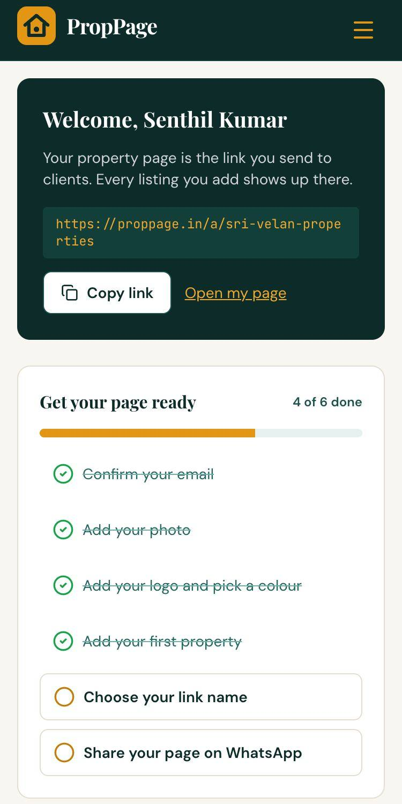

Sign in pannadhum varra screen **"Overview"**.

**Mela irukkura dark box:**

- Unga page link irukkum.
- **"Copy link"** — link copy aagum. WhatsApp-la paste pannalaam.
- **"Open my page"** — buyers paakura maadhiri unga page open aagum.

**"Get your page ready"** — 6 step checklist. Mudinja step-la green tick varum.

1. **"Confirm your email"**
2. **"Add your photo"**
3. **"Add your logo and pick a colour"**
4. **"Add your first property"**
5. **"Choose your link name"**
6. **"Share your page on WhatsApp"**

Ovvoru step-aiyum tap pannaa, adhu panna vendiya screen-ku pogum. 6-um mudinjaa indha box maranjidum.

 

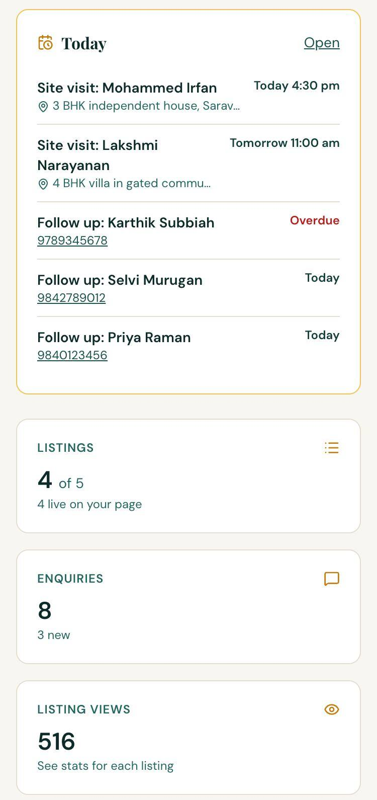

**"Today" box** — inniki panna vendiya velai:

- **"Site visit"** — inniki, naalaikku irukkura site visits, time-oda.
- **"Follow up"** — inniki call panna vendiya clients. Thaandipona follow-up-ku sigappu-la **"Overdue"** varum.
- **"Open"** tap pannaa Enquiries-la "Today" list open aagum.

**Count boxes:**

- **"Listings"** — "4 of 5" na, unga plan-la 5-la 4 use panniteenga. Keezha evvalavu live-a irukku nu varum.
- **"Enquiries"** — mottham enquiries, adhula evvalavu pudhusu ("new").
- **"Listing views"** — unga listings-a evvalavu peru paathaanga. Tap pannaa Stats varum.

Keezha **"Latest enquiries"** — kadaisi 5 enquiries. **"See all"** tap pannaa ellaam varum.

Trial-la irundhaa kadaisi-la "Your free trial has 14 days left. **See plans**" nu varum.

**Phone-la enquiry alert:** Overview-la **"Turn on enquiry alerts"** tap panni, phone kekkum bodhu **Allow** pannunga. Ippo pudhu enquiry vandha udane phone-la notification varum (PropPage moodi irundhaalum). Notification-la buyer peyar, listing per mattum varum; phone number app-kulla dhaan. iPhone-la mudhalla PropPage-a Home Screen-la add panni, angirundhu open panni alert on pannunga. Off panna **"Turn off"**.

 

---

## 4. Keezha irukkura menu, Language, Help

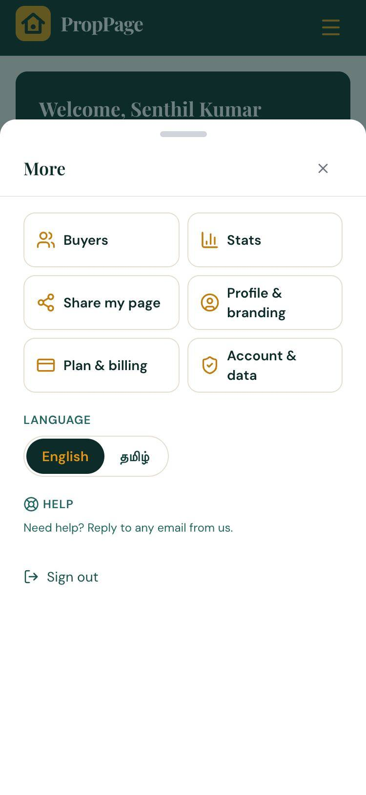

Phone-la screen keezha 5 button irukkum:

| Button | Enna pannum |
|---|---|
| **"Overview"** | Mudhal screen |
| **"Listings"** | Unga ellaa property-um (My properties) |
| **"Add"** (naduvula vattam) | Pudhu property add panna |
| **"Enquiries"** | Client enquiries, follow-ups |
| **"More"** | Matha ellaa screens |

**"More"** tap pannaa:

- **"Buyers"**, **"Stats"**, **"Share my page"**
- **"Profile & branding"**, **"Plan & billing"**, **"Account & data"**
- **"Language"** — **"English"** / **"தமிழ்"**
- **"Help"**
- **"Sign out"**

Computer-la paatha, idhe menu left side-la irukkum.

 

### 4.1 Tamil-la paakka

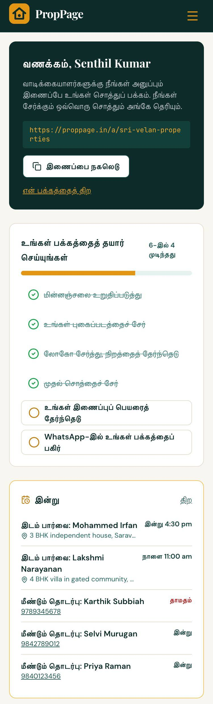

1. **"More"** tap pannunga.
2. **"Language"** keezha **"தமிழ்"** tap pannunga.
3. Ippo menu, buttons ellaam Tamil-la varum. Udhaaranam: "Overview" → "முகப்பு", "Enquiries" → "விசாரணைகள்".

English-ku thirumba maatha, **"மேலும்"** (More) → **"English"** tap pannunga.

> Indha manual-la button per English-la irukku. Tamil-la use pannaa, adhe idathula Tamil per irukkum.

 

### 4.2 Help

**"More"** → **"Help"** keezha:

- **"WhatsApp PropPage"** button irundhaa, adha tap panni PropPage team-ku message pannunga.
- Illana "Need help? Reply to any email from us." nu varum — PropPage anuppuna edhaavadhu oru email-ku reply pannunga.

---

## 5. Property add pannradhu

Keezha naduvula irukkura **"Add"** button tap pannunga. **"Add property"** screen varum.

### 5.1 "Speak or paste your listing" — pesi illa paste panni fill pannunga

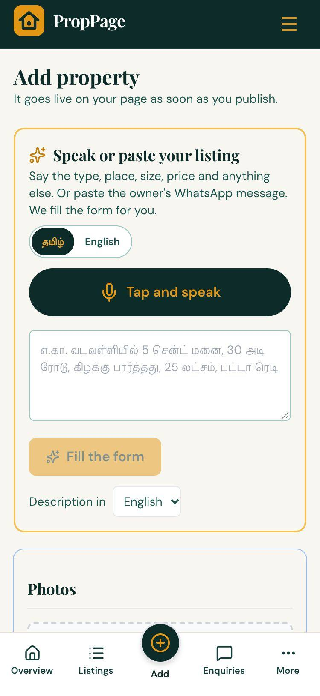

Form-a onnu onna type panna vendaam. Pesunga, illa owner anuppuna WhatsApp message-a paste pannunga. Form thaane fill aagum.

**Pesi fill panna:**

1. Mela **"தமிழ்"** illa **"English"** choose pannunga — endha mozhila pesa poreenga.
2. **"Tap and speak"** (mic button) tap pannunga.
3. Property type, area, size, price, matha details pesunga. Udhaaranam: "Vadavalli-la 5 cent plot, 30 adi road, east facing, 25 lakhs, patta ready."
4. Mudinjadhum **"Stop"** tap pannunga.
5. **"Fill the form"** tap pannunga.

**Paste panni fill panna:**

1. Owner-oda WhatsApp message-a copy pannunga.
2. Box-la paste pannunga.
3. **"Fill the form"** tap pannunga.

 

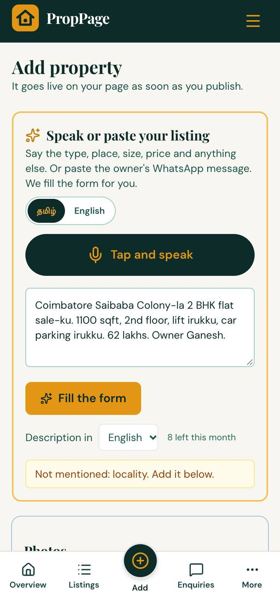

**Fill aana appuram:**

- "Form filled. Check every field before publishing." nu message varum.
- Edhaavadhu sollala-na, manjal box-la **"Not mentioned: …"** nu kaattum (udhaaranam: locality). Adha keezha form-la neengale fill pannunga.
- **"Description in"** — description English-la venumaa, Tamil-la venumaa nu choose pannalaam.
- "9 left this month" — indha maasam innum evvalavu dhadava use pannalaam.

**Maasathukku limit:** Free trial 10, Starter 50, Pro 300.

> **Mukkiyam:** Form fill aanadhum ellaa field-aiyum oru dhadava check pannunga. Price, size thappa irundhaa maathunga.
>
> Mic work aaga Chrome browser venum, microphone permission "Allow" pannanum. Mic illana kooda paste / type pannalaam.

 

**Ella box-layum pesi type pannalaam:** endha text box-a tap pannaalum, keyboard mela oru chinna mic button varum. Adha tap panni pesinaa, andha box-la type aagum.

### 5.2 Photos

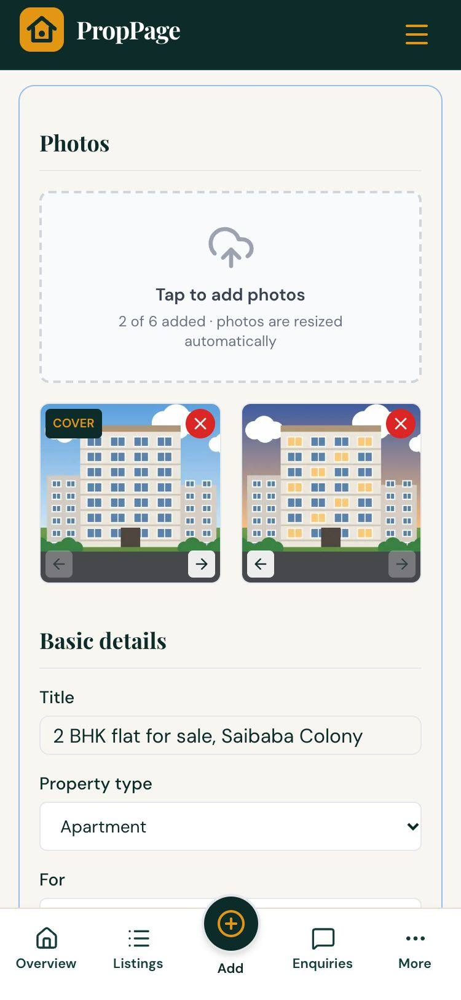

1. **"Tap to add photos"** tap pannunga.
2. Gallery-la irundhu photos select pannunga (ore dhadava neraya select pannalaam).
3. Photos upload aagum. Size thaane chinnadha aagum.

- **Mudhal photo dhaan "COVER".** WhatsApp preview-layum, list-layum adhu dhaan varum.
- Order maatha photo keezha irukkura **←** / **→** arrows use pannunga.
- Photo vendaam-na sigappu **×** tap pannunga.
- JPG, PNG, WebP photos mattum. Ovvonnum 20 MB-ku keezha irukkanum.

**Oru listing-ku evvalavu photo:** Free trial 6, Starter 10, Pro 15.

 

### 5.3 Details fill pannunga

**"Basic details":**

1. **"Title"** — chinna, theliva. Udhaaranam: "3 BHK villa near RS Puram".
2. **"Property type"** — Apartment, Villa, House, Plot, Commercial, Warehouse, Farm land, PG / hostel.
3. **"For"** — Sale, Sale (owner), Rent, Lease.
4. **"Price (₹)"** — full number. 25 lakhs-na `2500000`.
5. **"Price is"** — Total price, Per sq.ft, Per month, Per year.

**"Size":**

1. **"Area"** and **"Unit"** — Sq.ft, Cents, Acres, Grounds.
2. Veedu / flat-na **"Bedrooms"**, **"Bathrooms"**. (Plot, farm land-ku indha box varaadhu.)
3. **"Road facing (optional)"** — udhaaranam "30 ft road, east facing".

**"Location":**

1. **"City"** choose pannunga.
2. **"Locality"** — area per. Udhaaranam "Vadavalli".
3. **"Address shown to buyers"** — street / landmark mattum. **Door number podaadheenga.**
4. **"Pincode (optional)"**, **"Google Maps link (optional)"** — irundhaa podunga.

**"Description":**

1. **"About this property"** — property pathi 2–3 line.
2. **"Amenities (comma separated)"** — udhaaranam "Car parking, Borewell, Compound wall".

### 5.4 "Private notes" — ungalukku mattum

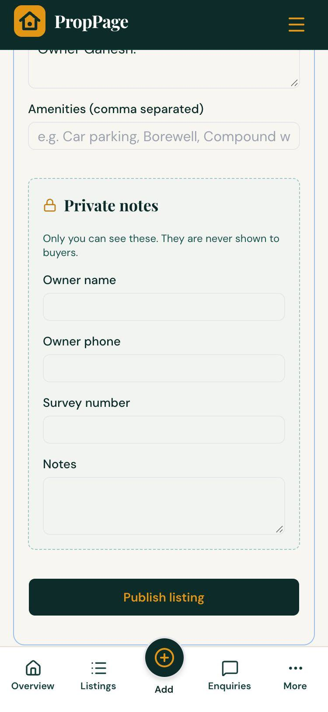

Indha box-la podradhu **buyers-ku eppavum theriyaadhu.** "Only you can see these. They are never shown to buyers."

- **"Owner name"**
- **"Owner phone"**
- **"Survey number"**
- **"Notes"** — udhaaranam "Cash-na 24 L-ku owner OK", "Key watchman kitta".

### 5.5 Publish pannunga

1. Ellaam check pannunga.
2. Keezha **"Publish listing"** tap pannunga.
3. "Listing published." nu varum. Property udane unga page-la varum.

Kuraindhadhu oru photo venum. Illana "Add at least one photo." nu kaattum.

**Plan limit mudinjaa:** "You can't add more listings right now" nu varum. Sold aanadha **"Mark sold"** pannunga, pazhaya listing delete pannunga, illa plan upgrade pannunga.

 

---

## 6. My properties — unga listings

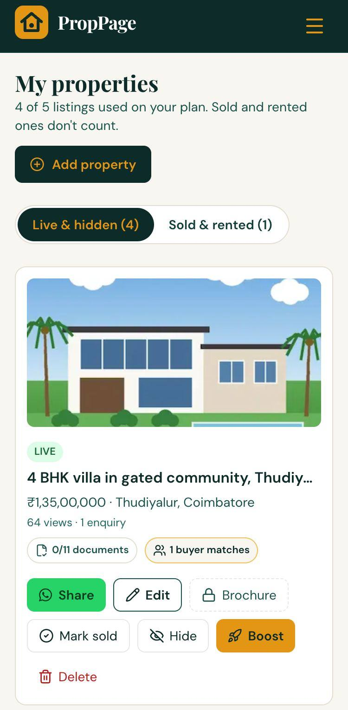

Keezha **"Listings"** tap pannunga.

Mela "4 of 5 listings used on your plan. Sold and rented ones don't count." nu varum — sold / rented aanadhu plan count-la serakkaadhu.

**Rendu tab irukku:**

- **"Live & hidden"** — ippo irukkura listings.
- **"Sold & rented"** — sold / rent-ku pona listings.

**Ovvoru listing card-la:**

- **"LIVE"** / **"HIDDEN"** / **"SOLD"** / **"RENTED"** nu status.
- Evvalavu views, evvalavu enquiries.
- **"5/11 documents"** — 11 title documents-la evvalavu verified. Tap pannaa documents page varum.
- **"1 buyer matches"** — unga saved buyers-la evvalavu peruku idhu match aagudhu. Tap pannaa Buyers screen varum.

 

**Card-la irukkura buttons:**

| Button | Enna pannum |
|---|---|
| **"Share"** | WhatsApp open aagum. Title, price, area, link ready-a irukkum. Contact choose panni anuppunga. |
| **"Edit"** | Details, photos maatha. Kadaisi-la **"Save changes"**. Title documents-um inga dhaan. |
| **"Brochure"** | Property-ku PDF brochure (Pro plan). Trial / Starter-la poottu (🔒) kaattum. |
| **"Mark sold"** / **"Mark rented"** | Deal mudinjaa. Keezha paarunga. |
| **"Hide"** | Page-la irundhu thatkaalikama maraikka. Thirumba kaatta **"Make live"**. |
| **"Boost"** | PropPage home page-la kaatta (₹149 / week). |
| **"Delete"** | Muzhusa azhikka. "Delete for good? Photos are removed too." → **"Delete"** illa **"Keep"**. |

### 6.1 "Mark sold" / "Mark rented"

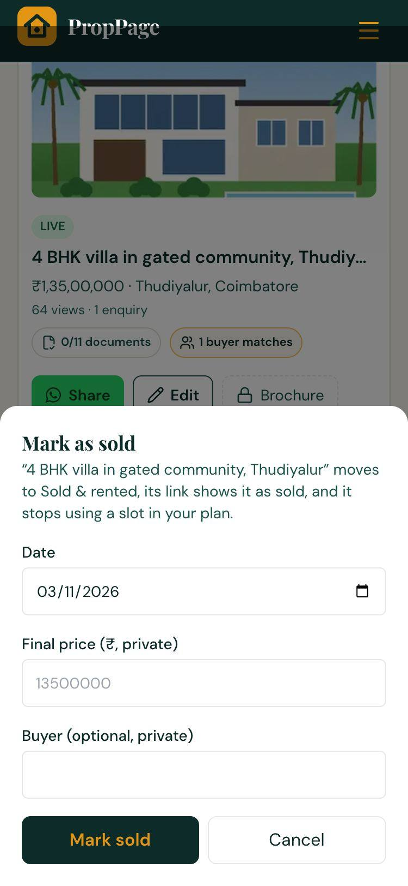

1. Listing card-la **"Mark sold"** (rent / lease-na **"Mark rented"**) tap pannunga.
2. **"Date"** — sold aana date.
3. **"Final price (₹, private)"** — final-a evvalavu-ku pochu. Idhu ungalukku mattum.
4. **"Buyer (optional, private)"** — vaanginavar per. Idhuvum private.
5. **"Mark sold"** tap pannunga.

Enna nadakkum:

- Listing **"Sold & rented"** tab-ku pogum. History apdiye irukkum.
- Unga plan-la oru slot free aagum. Pudhu listing podalaam.
- Pazhaya link-a yaaraavadhu open pannaa "THIS PROPERTY IS SOLD" nu kaattum, keezha unga matha listings kaattum.

Thappa mark panniteenga-na, **"Sold & rented"** tab-la **"Make live again"** tap pannunga.

 

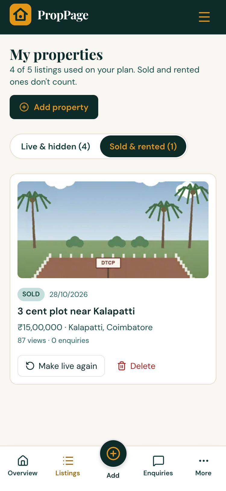

**"Sold & rented"** tab-la ellaa sold / rented listings-um views, enquiries history-oda irukkum. "When you mark a listing sold or rented it moves here, keeps its history, and frees a slot in your plan."

 

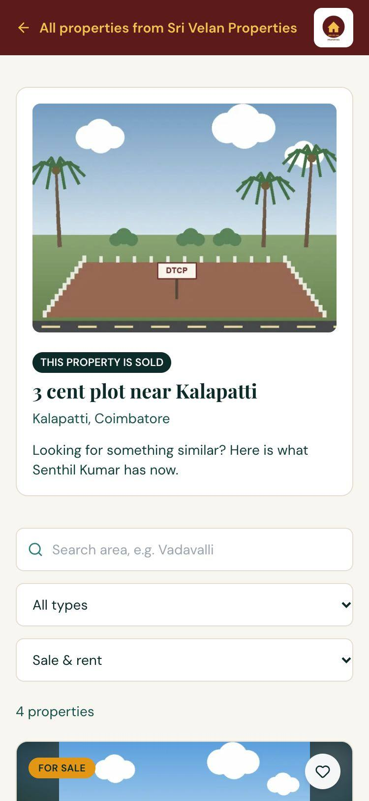

**Sold link buyers-ku ippadi theriyum** — "Looking for something similar? Here is what Senthil Kumar has now." nu, unga matha properties kaattum. Pazhaya link waste aagaadhu.

**"Profile & branding"**-la **"Show my recently sold and rented properties on my page"** tick pannirundhaa, sold properties unga page-layum kaattum (nambikkai-ku nalladhu).

 

### 6.2 "Boost" — PropPage home page-la kaatta

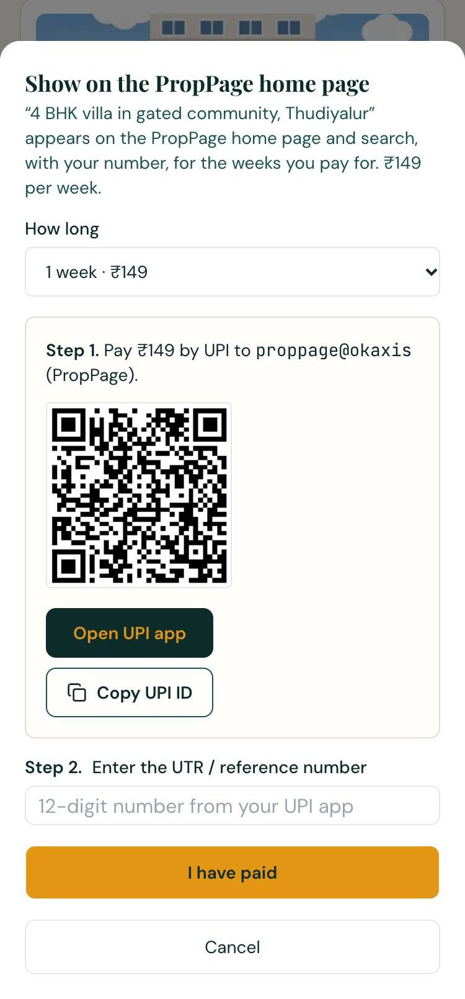

Boost pannaa unga property **PropPage home page-layum search-layum** unga number-oda varum. Ungalukku theriyaadha pudhu buyers-um paappaanga.

1. Listing card-la **"Boost"** tap pannunga.
2. **"How long"** — 1 week ₹149, 2 weeks ₹298, 4 weeks ₹596.
3. **Step 1** — QR code scan pannunga, illa **"Open UPI app"** tap pannunga. Kaattura amount pay pannunga.
4. **Step 2** — UPI app-la varra **UTR / reference number** type pannunga.
5. **"I have paid"** tap pannunga.

Admin check panni approve pannadhum card-la **"On home page until …"** nu date varum.

 

### 6.3 "Brochure" (Pro)

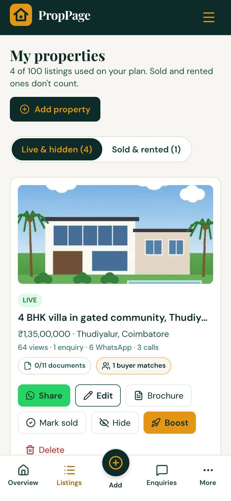

Pro plan-la listing card-la **"Brochure"** button open-a irukkum, views pakkathula WhatsApp taps, calls-um kaattum.

1. Listing card-la **"Brochure"** tap pannunga.
2. "Making PDF…" nu konja neram varum.
3. Unga logo, colour, photos, details, phone number-oda PDF download aagum.
4. Adha WhatsApp-la client-ku anuppunga, illa print pannunga.

Trial / Starter-la indha button-la poottu irukkum. Tap pannaa "Plan & billing" pogum.

 

---

## 7. Title documents

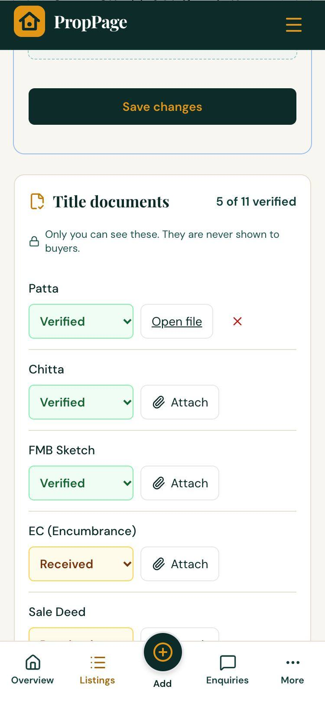

Ovvoru property-kum 11 documents track pannalaam. Idhu **ungalukku mattum** — buyers-ku theriyaadhu.

**Eppadi open pannradhu:** Listing card-la **"Edit"** tap panni keezha scroll pannunga. Illa **"x/11 documents"** chip-a tap pannunga.

**11 documents:** Patta, Chitta, FMB Sketch, EC (Encumbrance), Sale Deed, Parent Document, Tax Receipt, Survey Sketch, Aadhaar / ID Proof, DTCP / CMDA Approval, Building Plan.

1. Ovvoru document pakkathulayum status choose pannunga:
   - **"Not received"** — innum kaila varala.
   - **"Received"** — copy vandhuduchu, check pannala.
   - **"Verified"** — check panniyaachu, OK.
2. Copy irundhaa **"Attach"** tap panni PDF illa photo podunga (10 MB-ku keezha).
3. Pottadha paakka **"Open file"**. Remove panna sigappu **×**.

Mela "5 of 11 verified" nu mottham varum. Listing card-layum "5/11 documents" nu kaattum.

 

---

## 8. Buyers unga page-la enna paarpaanga

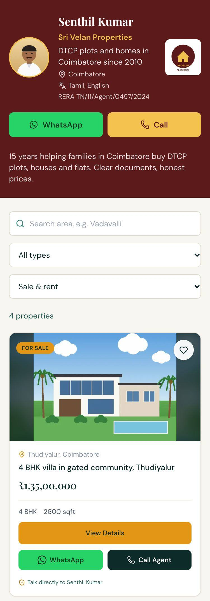

Unga link-a open pannaa buyer paakuradhu:

- Mela unga photo, peyar, agency, logo, tagline, ooru, languages, RERA number.
- Perisa **"WhatsApp"**, **"Call"** buttons — tap pannaa neraa ungalukku varum.
- "About you" text.
- Area search, **"All types"**, **"Sale & rent"** filters.
- Unga ellaa live listings.

Unga page colour, logo ellaam **"Profile & branding"**-la maathalaam.

 

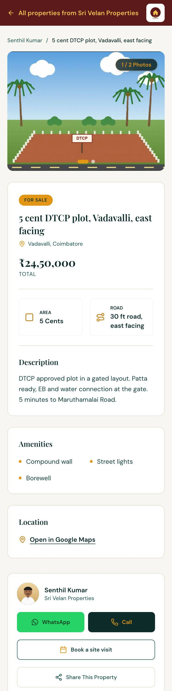

**Oru listing open pannaa:**

- Photos (swipe panni paakkalaam), price, area, road, description, amenities.
- **"Open in Google Maps"** (neenga Maps link pottirundhaa).
- Unga peyar-oda **"WhatsApp"**, **"Call"**, **"Book a site visit"**, **"Share This Property"**.
- **"EMI Calculator"**.
- Keezha eppavum WhatsApp, Call, **"Enquire now"** buttons.

Buyer **"Enquire now"** form fill pannaa, adhu unga **"Enquiries"**-la varum, ungalukku email-um varum.

**Buyer-ku eppavum theriyaadhadhu:** owner per, owner phone, survey number, private notes, title documents, sold price.

Link-a WhatsApp-la anuppumbodhu, photo-oda oru preview card varum.

 

---

## 9. Enquiries — yaar kettaanga, follow-up

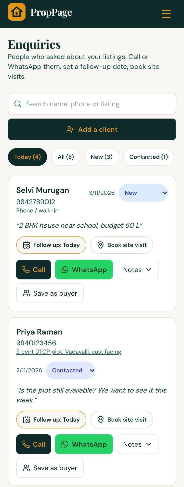

Keezha **"Enquiries"** tap pannunga.

Unga page-la form fill pannavanga, neenga add panna clients ellaam inga.

**Mela:**

- **Search box** — "Search name, phone or listing".
- **"Add a client"** — phone / walk-in client-a neengale add panna.
- **Filters:** **"Today"**, **"All"**, **"New"**, **"Contacted"**, **"Site visit"**, **"Negotiation"**, **"Closed"**, **"Lost"** — brackets-la count.

**"Today"** filter — inniki follow-up, overdue follow-up, inniki site visit irukkuravanga mattum. Kaalaila mudhalla idha paarunga.

**Ovvoru enquiry card-la:** peyar, phone, endha property, date, status, avanga message.

 

### 9.1 Status maathunga

Card-la irukkura colour box-a tap panni status choose pannunga:

**"New"** → **"Contacted"** → **"Site visit"** → **"Negotiation"** → **"Closed"** (deal aachu) illa **"Lost"** (pochu).

**"Call"** illa **"WhatsApp"** tap pannaa, New-a irundhaa thaane "Contacted" aagidum.

### 9.2 Call / WhatsApp

- **"Call"** — phone dialer open aagum.
- **"WhatsApp"** — "Hi …, thanks for your enquiry about …" nu message ready-a WhatsApp open aagum.

### 9.3 Follow-up date podunga

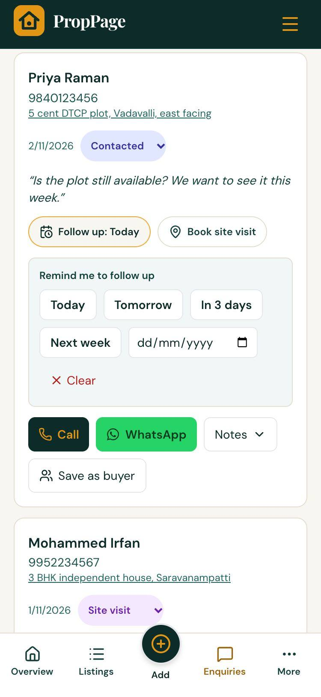

1. Card-la **"Set follow-up"** tap pannunga.
2. "Remind me to follow up" keezha choose pannunga: **"Today"**, **"Tomorrow"**, **"In 3 days"**, **"Next week"**, illa calendar-la date pick pannunga.
3. "Follow-up set for …" nu varum. Button-la **"Follow up: Tomorrow"** maadhiri kaattum.
4. Andha naal vandhaa Overview "Today" box-layum, kaalai email-layum varum.
5. Reminder vendaam-na **"Clear"**.

Date thaandipochu-na sigappu-la **"Overdue: …"** nu kaattum.

 

### 9.4 Site visit book pannunga

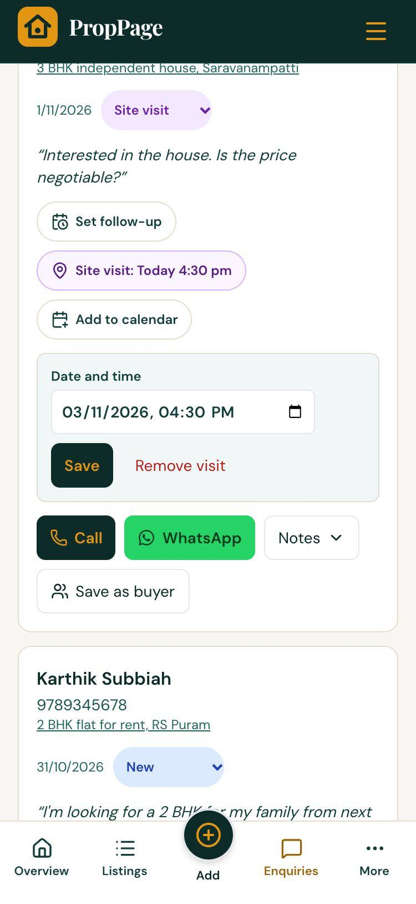

1. Card-la **"Book site visit"** tap pannunga.
2. **"Date and time"** choose pannunga.
3. **"Save"** tap pannunga. "Site visit saved." varum. Status "New" / "Contacted"-a irundhaa thaane **"Site visit"** aagidum.
4. Phone calendar-la poda **"Add to calendar"** tap pannunga (Google Calendar open aagum).
5. Cancel aana **"Remove visit"**.

Inniki / naalaikku site visit Overview "Today" box-la time-oda varum.

 

### 9.5 Notes

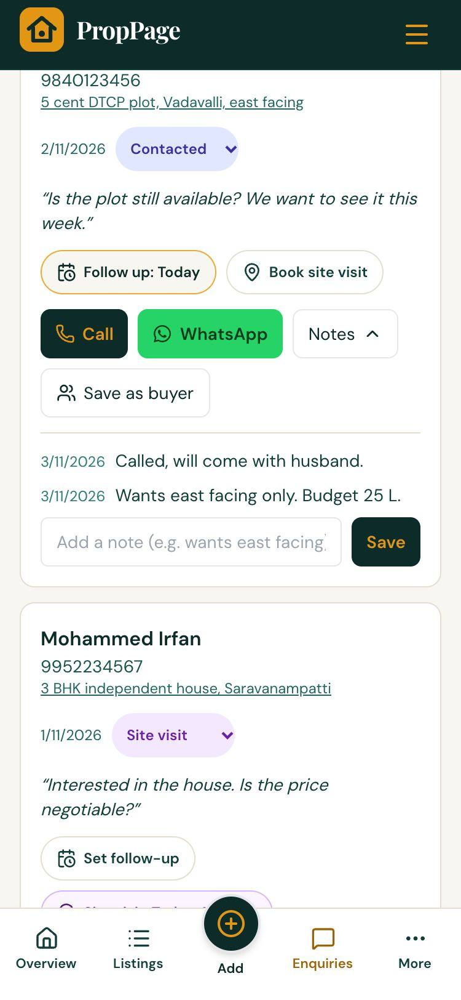

1. Card-la **"Notes"** tap pannunga.
2. Box-la type pannunga — udhaaranam "Wants east facing", "Husband-oda Sunday varuvaanga".
3. **"Save"** tap pannunga.

Ovvoru note-um date-oda save aagum. Adutha dhadava call pannumbodhu enna pesunom nu nyaabagam irukkum.

 

### 9.6 "Add a client" — phone / walk-in client

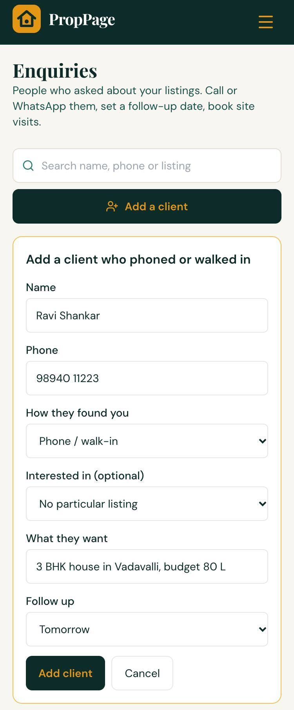

Phone pannavanga, office-ku vandhavanga, yaaraavadhu refer pannavanga — ivangalayum inga podalaam.

1. **"Add a client"** tap pannunga.
2. **"Name"**, **"Phone"**.
3. **"How they found you"** — Phone / walk-in, WhatsApp, Referral.
4. **"Interested in (optional)"** — endha listing, illa "No particular listing".
5. **"What they want"** — udhaaranam "2 BHK near school, budget 50 L".
6. **"Follow up"** — No reminder, Today, Tomorrow, In 3 days, Next week.
7. **"Add client"** tap pannunga.

 

**WhatsApp-la vandha client-a seekiram add panna:**

1. WhatsApp-la client-oda message-a (illa contact-a) long-press panni **Copy** pannunga.
2. PropPage **"Add a client"** form-la **"Paste from WhatsApp (optional)"** box-la paste pannunga.
3. Peyar, phone number, avanga enna kettaanga — ellaam thaane fill aagum. **"How they found you"** WhatsApp-nu maarum.
4. Check panni **"Add client"** tap pannunga.

Adhe number munnaadiye unga enquiries-la irundhaa, "… is already in your enquiries with this number." nu kaattum. **"Show them"** tap pannaa andha pazhaya client varum; pudhusa venumna **"Add anyway"**.

### 9.7 "Save as buyer"

Client-ku enna venum nu theriyum-na, card-la **"Save as buyer"** tap pannunga. Peyar, phone ready-a Buyers form open aagum. Adutha section paarunga.

---

## 10. Buyers — client enna thedraanga

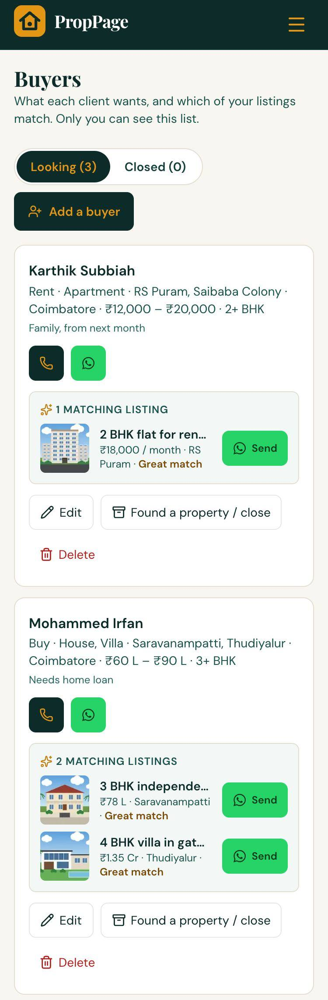

**"More"** → **"Buyers"**.

Ovvoru client-um enna thedraanga nu save pannunga. Unga listings-la edhu match aagudhu nu PropPage kaattum. Ore tap-la WhatsApp-la anuppalaam. Indha list ungalukku mattum.

**Mela rendu tab:** **"Looking"** (innum thedravanga), **"Closed"** (kedaichiduchu).

**Ovvoru buyer card-la:**

- Buy / Rent, type, area, budget, bedrooms.
- Call, WhatsApp icons.
- **"1 matching listing"** / **"2 matching listings"** — unga live listings-la match aanadhu.
- Ovvonnukkum **"Great match"**, **"Good match"**, illa **"Partial match"**.
- **"Send"** — "Hi …, this property matches what you are looking for: … See photos: link" nu WhatsApp message ready.

Pudhu listing add pannaa, match aana buyers-ku thaane inga kaattum.

 

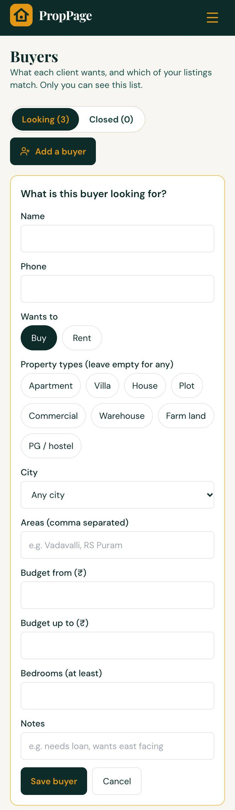

### 10.1 Buyer add pannunga

1. **"Add a buyer"** tap pannunga (illa Enquiries-la **"Save as buyer"**).
2. **"Name"**, **"Phone"**.
3. **"Wants to"** — **"Buy"** illa **"Rent"**.
4. **"Property types (leave empty for any)"** — Apartment, Villa, House, Plot… onnu-ku mela tap pannalaam.
5. **"City"**, **"Areas (comma separated)"** — udhaaranam "Vadavalli, RS Puram".
6. **"Budget from (₹)"**, **"Budget up to (₹)"** (Rent-na maasa vaadagai).
7. **"Bedrooms (at least)"**.
8. **"Notes"** — udhaaranam "needs loan, wants east facing".
9. **"Save buyer"** tap pannunga. Matching listings udane keezha varum.

**Matha buttons:**

- **"Edit"** — maatha.
- **"Found a property / close"** — kedaichiduchu. "Closed" tab-ku pogum.
- **"Looking again"** — thirumba thedraanga-na (Closed tab-la).
- **"Delete"** — azhikka.

 

---

## 11. Stats

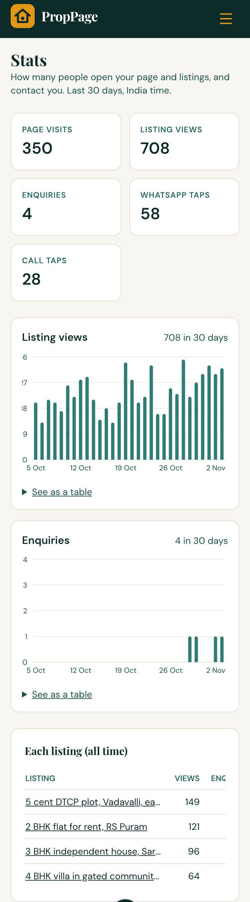

**"More"** → **"Stats"**. Kadaisi 30 naal (India time).

**Ellaa plan-layum:**

- **"Page visits"** — unga page evvalavu dhadava open aachu.
- **"Listing views"** — listings evvalavu dhadava paathaanga.
- **"Enquiries"** — evvalavu enquiries vandhuchu.
- **"Each listing (all time)"** — ovvoru listing-kum views, enquiries.

**Pro plan-la mattum:**

- **"WhatsApp taps"**, **"Call taps"** — unga page-la WhatsApp / Call button evvalavu dhadava tap pannaanga.
- Naal vaari chart. **"See as a table"** tap pannaa table-a paakkalaam.

 

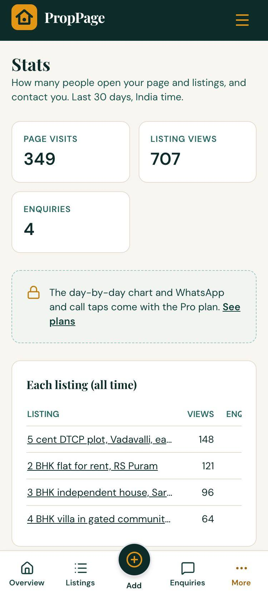

Trial / Starter-la ippadi varum: "The day-by-day chart and WhatsApp and call taps come with the Pro plan." **"See plans"** tap pannaa Plan & billing pogum.

 

---

## 12. Share my page — link, poster, visiting card

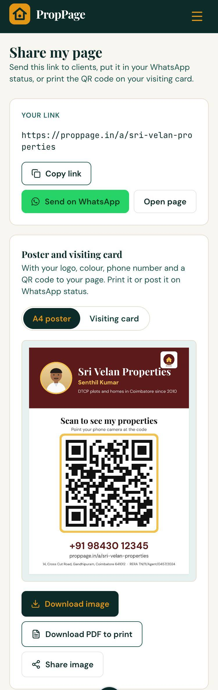

**"More"** → **"Share my page"**.

**"Your link":**

- **"Copy link"** — copy panni WhatsApp group, status, Facebook-la podunga.
- **"Send on WhatsApp"** — "Hi! See all my properties here:" + link ready-a WhatsApp open aagum.
- **"Open page"** — unga page-a paakka.

**"Poster and visiting card"** — unga logo, colour, phone number, unga page-ku QR code-oda ready-made design.

1. **"A4 poster"** illa **"Visiting card"** choose pannunga.
2. **"Download image"** — photo-va save aagum. WhatsApp status-la podalaam.
3. **"Download PDF to print"** — print shop-la kudukka PDF.
4. **"Share image"** — phone-la neraa WhatsApp-ku anuppa.

Client QR code-a phone camera-la scan pannaa unga page open aagum. Office-la, site board-la ottunga.

 

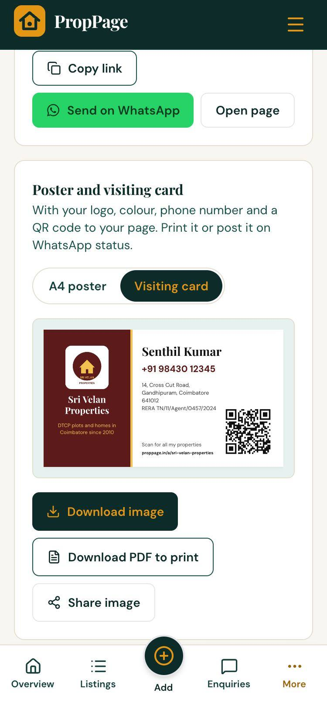

**Visiting card** — munnaadi unga logo, peyar, phone, address; pinnaadi QR code.

Logo illana "Tip: add your logo in Profile & branding and it appears here." nu varum. Logo pottaa design-la thaane varum.

 

---

## 13. Profile & branding

**"More"** → **"Profile & branding"**. Buyers unga page mela paakuradhu ellaam inga dhaan.

### 13.1 Profile

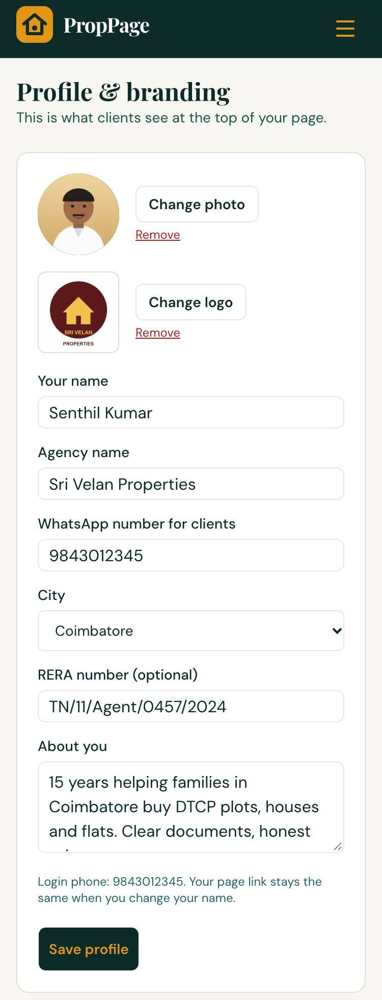

1. **"Add photo"** / **"Change photo"** — unga mugam therira photo.
2. **"Add logo"** / **"Change logo"** — unga agency logo. Page, listings, WhatsApp preview, poster ellaathulayum varum.
3. **"Your name"**, **"Agency name"**.
4. **"WhatsApp number for clients"** — buyers indha number-ku dhaan WhatsApp / call pannuvaanga.
5. **"City"**.
6. **"RERA number (optional)"**.
7. **"About you"** — 2 line. Udhaaranam "15 years helping families in Coimbatore…".
8. **"Save profile"** tap pannunga.

Peyar maathinaalum unga link maaraadhu.

 

### 13.2 Branding — colour, tagline, office

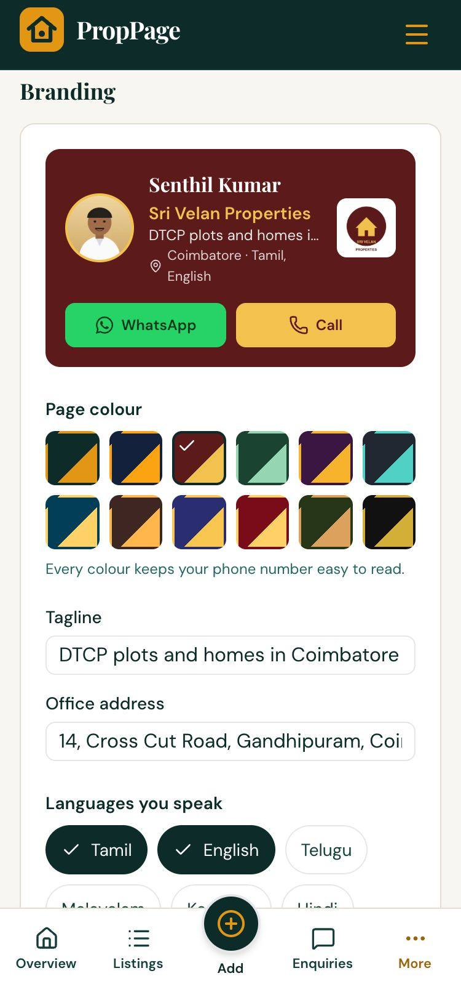

Mela unga page header eppadi irukkum nu preview kaattum. Maathumbodhe preview maarum.

1. **"Page colour"** — 12 colours irukku (Teal, Navy, Maroon, Forest, Plum, Charcoal, Ocean, Earth, Indigo, Crimson, Olive, Black & gold). Unga logo-ku match aagura colour tap pannunga. Edha choose pannaalum phone number theliva theriyum.
2. **"Tagline"** — oru line. Udhaaranam "DTCP plots and homes in Coimbatore since 2010".
3. **"Office address"**.
4. **"Languages you speak"** — Tamil, English, Telugu, Malayalam, Kannada, Hindi.
5. **"Social links (optional)"** — Website, Facebook page, Instagram, YouTube channel. `https://` -la start aaganum.
6. **"Show my recently sold and rented properties on my page"** — tick pannaa sold properties-um page-la kaattum.
7. **"Save branding"** tap pannunga.

 

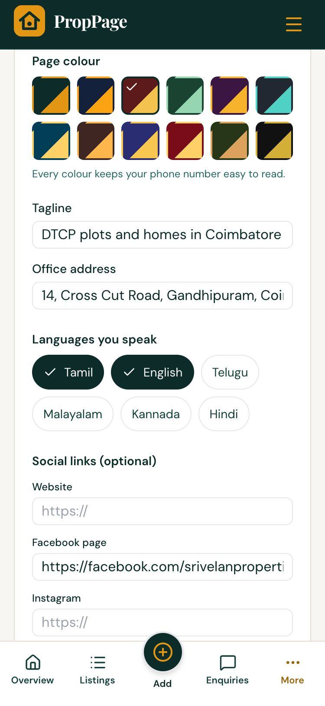

Tagline, office address, languages, social links ippadi fill pannunga. Neenga pesura mozhigal-a tap pannaa tick (✓) varum.

 

### 13.3 "Pro extras"

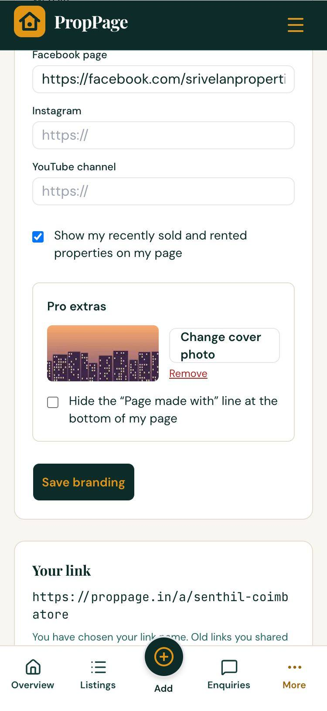

Pro plan-la mattum:

- **"Add cover photo"** — unga page mela perisa oru background photo.
- **"Hide the “Page made with” line at the bottom of my page"** — page keezha "Page made with PropPage" line-a maraikka.
- Listings-la **"Brochure"** PDF.
- Unga peyar pakkathula **verified badge** (✓).

Trial / Starter-la poottu-oda "Cover photo, property brochure PDF and removing the footer come with the Pro plan. **See plans**" nu varum.

 

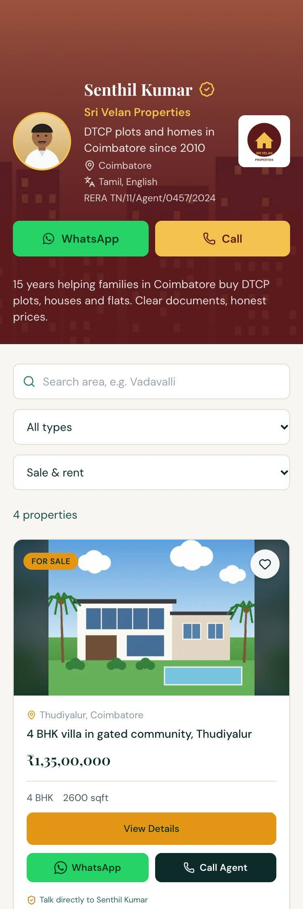

Pro-la cover photo, verified badge-oda unga page ippadi theriyum.

 

### 13.4 "Choose your link name" — **oru dhadava dhaan**

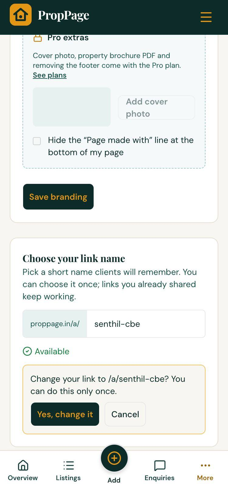

Signup pannumbodhu unga agency per-la oru link thaane varum. Client nyaabagam vechikka easy-aana per vechikkalaam.

1. **"Profile & branding"** keezha scroll pannunga.
2. Box-la pudhu per type pannunga. Udhaaranam `senthil-coimbatore`.
3. **"Your link will be: …"** nu kaattum. Yaarum use pannala-na green-la **"Available"** varum.
4. **"Use this link"** tap pannunga.
5. "Change your link to …? You can do this only once." nu kekkum. **"Yes, change it"** tap pannunga.
6. "Your new link is ready. The old one still works." nu varum.

> **Oru dhadava dhaan maatha mudiyum.** Yosichu per vainga. Munnaadi anuppuna pazhaya link-um innum work aagum — adhe page-ku pogum.

 

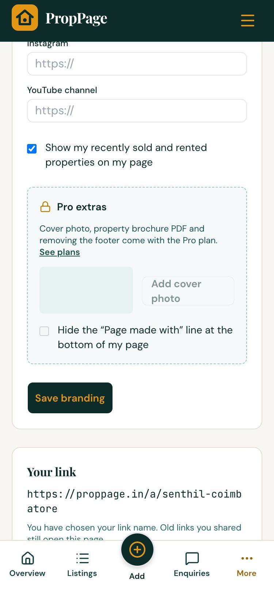

Maathunadhukku appuram andha box **"Your link"** nu maarum: "You have chosen your link name. Old links you shared still open this page."

 

---

## 14. Plan & billing — UPI-la pay pannradhu

**"More"** → **"Plan & billing"**.

### 14.1 Plans

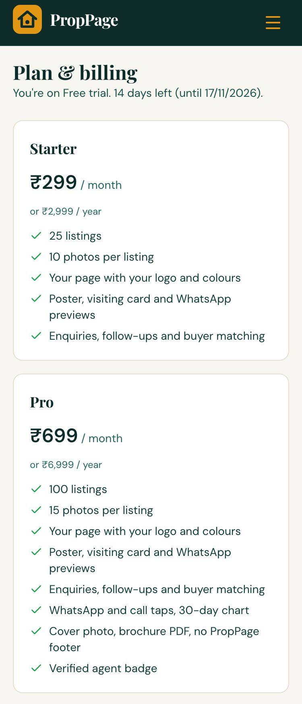

| | Free trial | Starter | Pro |
|---|---|---|---|
| Vilai | ₹0, 14 naal | ₹299 / month, illa ₹2,999 / year | ₹699 / month, illa ₹6,999 / year |
| Listings | 5 | 25 | 100 |
| Oru listing-ku photos | 6 | 10 | 15 |
| Speak / paste (maasathukku) | 10 | 50 | 300 |
| Logo, colour, poster, visiting card | ✓ | ✓ | ✓ |
| Enquiries, follow-ups, buyer matching | ✓ | ✓ | ✓ |
| WhatsApp / call taps, 30-day chart | — | — | ✓ |
| Cover photo, brochure PDF, footer maraikka | — | — | ✓ |
| Verified agent badge | — | — | ✓ |

Mela "You're on Free trial. 14 days left (until …)." maadhiri unga plan, evvalavu naal irukku nu kaattum.

Sold / rented listings plan count-la serakkaadhu.

 

### 14.2 UPI-la pay pannunga

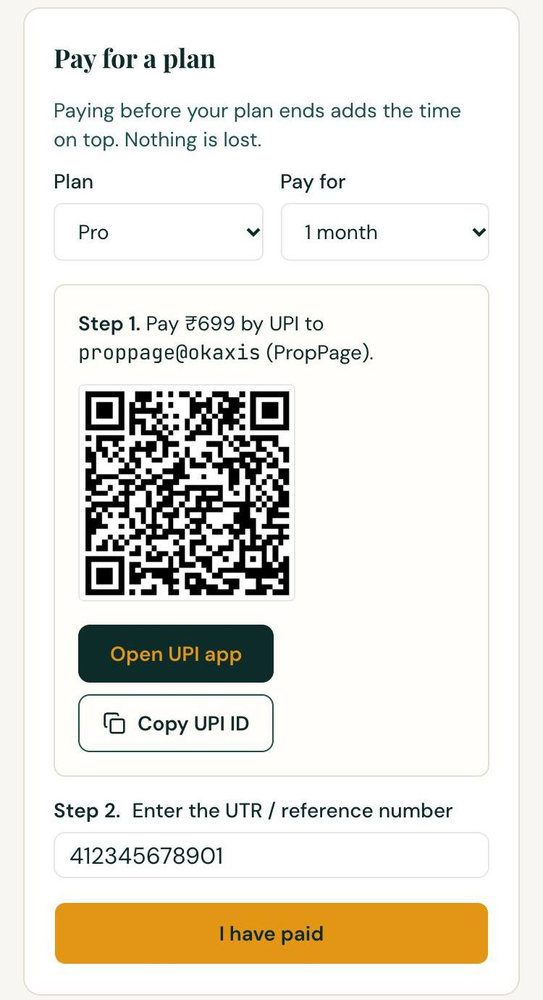

1. **"Pay for a plan"** box-ku scroll pannunga.
2. **"Plan"** — **Starter** illa **Pro**.
3. **"Pay for"** — **"1 month"** illa **"1 year (save more)"**.
4. **Step 1.** Kaattura amount-a kaattura UPI ID-ku pay pannunga:
   - Innoru phone-la irundhaa, **QR code**-a GPay / PhonePe / Paytm-la scan pannunga.
   - Adhe phone-na, **"Open UPI app"** tap pannunga — amount ready-a varum.
   - Illa **"Copy UPI ID"** panni UPI app-la paste pannunga.
5. Pay aanadhum UPI app-la payment details open pannunga. **UTR / UPI Ref No / Transaction ID** nu 12 digit number irukkum. Adha copy pannunga.
6. **Step 2.** **"Enter the UTR / reference number"** box-la paste pannunga.
7. **"I have paid"** tap pannunga.
8. "Payment sent for checking. We'll switch it on within a few hours." nu varum.

> Ore UTR-a rendu dhadava use panna mudiyaadhu.

 

### 14.3 "Being checked" → "Approved"

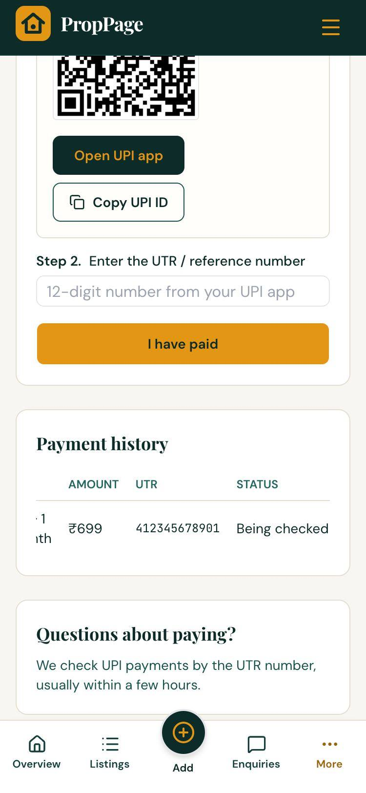

**"Payment history"**-la unga payment varum:

- **"Being checked"** — PropPage team bank-la check pannraanga. Usually sila mani neram.
- **"Approved"** — plan on aagiduchu. Email-um varum ("Payment received — thank you").
- **"Not found — please contact us"** — payment kedaikkala. Screenshot-oda support-ku message pannunga.

Phone-la table perisa irundhaa, **"Status"** paakka table-a idathu pakkam swipe pannunga.

 

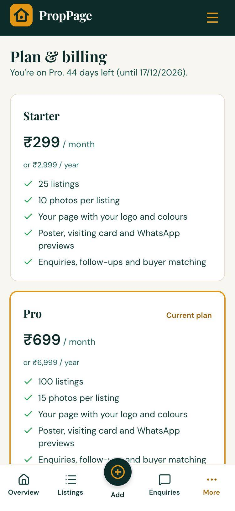

**Seekiram renew pannaa naal waste aagaadhu.** Plan mudiyaradhukku munnaadi pay pannaa, pudhu naal pazhaya mudivu date-kku **mela** serum.

Udhaaranam: trial 17 Nov varaikkum irukku. 3 Nov-e Pro 1 month pay pannaa, Pro 17 Dec varaikkum.

 

### 14.4 Plan mudinjaa enna aagum?

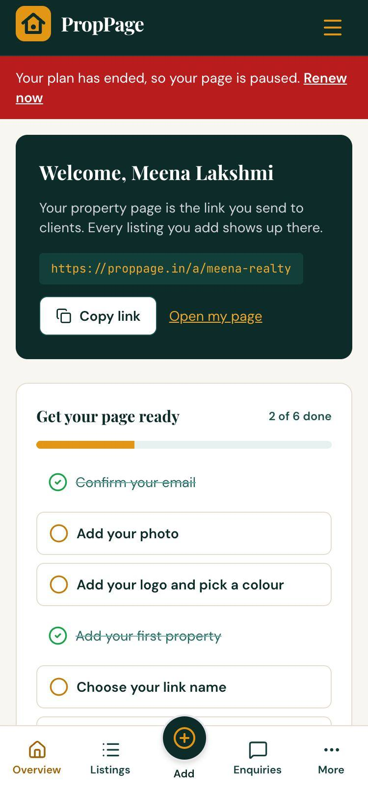

**Mudhal 7 naal (grace):**

- Unga page innum **live**-a irukkum. Buyers paakalaam, enquiry anuppalaam. Neenga share panna link waste aagaadhu.
- Dashboard mela sigappu-la "Your plan has ended. Your page stays live until (date), then it pauses. **Renew now**" varum.
- Pudhu listing add panna mudiyaadhu, "Speak or paste" use panna mudiyaadhu. Irukkura listings edit pannalaam, sold mark pannalaam.
- Indha 7 naal-kulla pay pannaa, pudhu plan pazhaya mudivu date-la irundhu kanakku aagum.

**7 naal kazhichu:**

- Dashboard-la "Your plan has ended, so your page is paused. **Renew now**" varum.
- Unga page buyers-ku **paused**-a kaattum. Pudhu enquiries varaadhu.
- **Edhuvum delete aagaadhu.** Listings, photos, enquiries, buyers ellaam safe-a irukkum.
- Pay panni approve aanadhum page udane thirumba varum.

Plan mudiyaradhukku 5 naal munnaadhilirundhu manjal-la "Free trial ends in 3 days. **Renew**" nu nyaabagapaduthum.

 

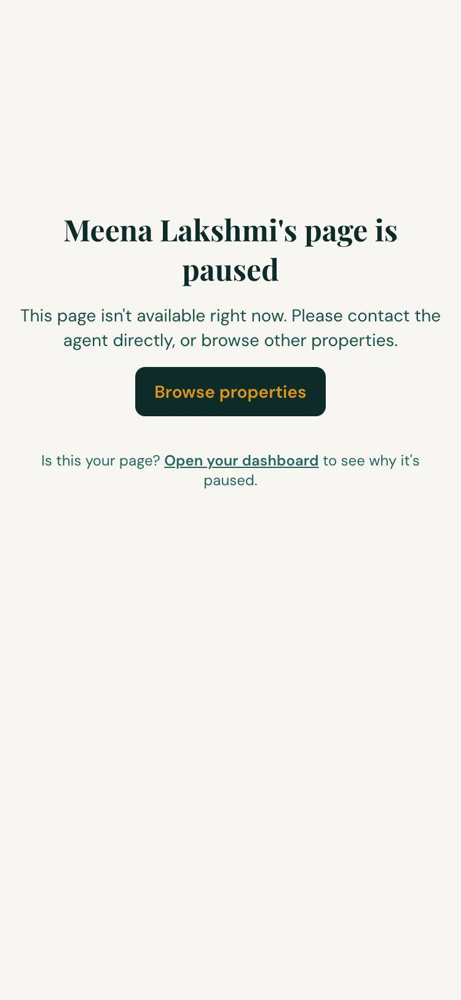

Paused aana page buyers-ku ippadi theriyum: "… page is paused. Please contact the agent directly, or browse other properties."

 

---

## 15. Account & data

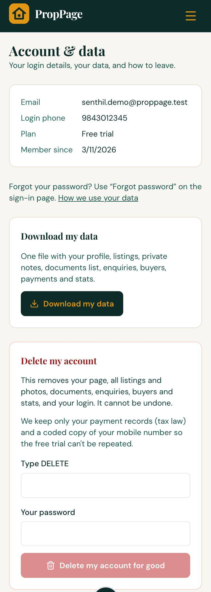

**"More"** → **"Account & data"**.

Mela unga **Email**, **Login phone**, **Plan**, **Member since** varum. **"How we use your data"** — privacy policy.

**"Download my data":**

1. **"Download my data"** tap pannunga.
2. Oru file download aagum — profile, listings, private notes, documents list, enquiries, buyers, payments, stats ellaam adhula.

**"Delete my account"** — **thirumba edukka mudiyaadhu.**

1. **"Type DELETE"** box-la `DELETE` nu capital letters-la type pannunga.
2. **"Your password"** podunga.
3. **"Delete my account for good"** tap pannunga.

Page, listings, photos, documents, enquiries, buyers, stats, login ellaam azhinjidum. Tax law-ku payment records mattum, free trial thirumba edukka koodaadhu nu mobile number-oda oru coded copy mattum vechippom.

 

---

## 16. Ungalukku varra emails, help

**PropPage anuppura emails:**

| Email | Eppo varum |
|---|---|
| Email confirm link | Signup pannumbodhu |
| "New enquiry: …" | Buyer unga listing-la enquiry form fill pannumbodhu — peyar, phone, message-oda |
| "Your free trial ends in 3 days" / "Your plan ends in 3 days" | Plan mudiyaradhukku 7, 3, 1 naal munnaadi, mudiyura naal, mudinja adutha naal, page pause aagaradhukku munnaadi naal. **"Renew my plan"** button irukkum. |
| "Good morning! Today you have:" (subject: "… follow-ups and visits today") | Kaalaila — inniki follow-up / site visit irundhaa mattum. **"Open today's list"** tap pannaa Today list open aagum. |
| "Payment received — thank you" / "We couldn't find your payment" | Admin unga payment-a check pannadhum |

**Help venumna:**

- **"More"** → **"Help"** — WhatsApp PropPage button irundhaa adha tap pannunga.
- **"Plan & billing"** keezha **"Questions about paying?"** box.
- Illana PropPage anuppuna edhaavadhu email-ku reply pannunga.

---

## 17. FAQ — adikkadi kekkura kelvigal

**Page paused nu varudhu, enna pannanum?**
Rendu kaaranam irukkalaam:
1. Email confirm pannala — Overview-la manjal box paarunga. Email link click panni, PropPage-ku thirumba vaanga (illa **"I've confirmed my email"** tap pannunga).
2. Plan mudinju 7 naal grace-um mudinjiduchu — **"Plan & billing"**-la pay pannunga. Approve aanadhum page thirumba varum.
Account-ae paused-na ("Your account is paused") support-ku message pannunga.

**Buyer-ku owner number theriyuma?**
Illa. **"Private notes"** (owner name, owner phone, survey number, notes), title documents, sold price — ivai ungalukku mattum. Buyer-ku unga WhatsApp number mattum dhaan theriyum.

**Photo upload aagala.**
- Internet check pannunga, thirumba try pannunga.
- JPG, PNG, WebP photos mattum. 20 MB-ku keezha.
- Unga plan photo limit mudinjiruchaa paarunga (trial 6, Starter 10, Pro 15).
- Chrome browser-la try pannunga.

**Enquiry vandhaa eppadi theriyum?**
- **"Turn on enquiry alerts"** on pannirundhaa, phone-la udane notification varum.
- Ungalukku "New enquiry: …" nu email varum.
- **"Enquiries"**-la **"New"** count yerum. Overview-layum kaattum.
- Kaalaila follow-up email-um varum.

**Mic work aagala / pesi type aagala.**
Chrome browser use pannunga. Mic permission kettaa **"Allow"** pannunga. Illana owner message-a paste pannunga, illa type pannunga.

**Link name maathanum.**
**"Profile & branding"** → **"Choose your link name"**. Oru dhadava dhaan mudiyum. Pazhaya link-um work aagum.

**Pay panniten, plan innum maaralai.**
**"Payment history"**-la **"Being checked"**-a irundhaa sila mani neram wait pannunga. UTR correct-a pottomaa nu check pannunga. "Not found — please contact us" vandhaa, payment screenshot-oda support-ku anuppunga.

**Listing limit mudinjiduchu.**
Sold aanadha **"Mark sold"** / **"Mark rented"** pannunga (slot free aagum), thevaiyillaadhadha delete pannunga, illa Starter / Pro-ku upgrade pannunga.

**Rendaavadhu free trial edukkalaamaa?**
Illa. Oru mobile number-ku oru trial dhaan.

**Password marandhuten.**
Sign in page-la email type panni **"Forgot password"** tap pannunga.

**Sold aana property link enna aagum?**
"THIS PROPERTY IS SOLD" nu kaattum, keezha unga matha properties-um kaattum. Link waste aagaadhu.

**Signup pannumbodhu "Too many signups from this network" varudhu.**
Ore Wi-Fi-la irundhu neraya signup aanadhaala. Oru mani neram kazhichu try pannunga, illa mobile data-la try pannunga.

**Property thatkaalikama maraikkanum.**
Listing card-la **"Hide"** tap pannunga. Thirumba kaatta **"Make live"**.

**Tamil-la use pannalaamaa?**
**"More"** → **"Language"** → **"தமிழ்"**.
