# PropPage — Admin Guide (Tanglish)

Idhu PropPage nadathura admin-ukku. Agents-ukkaana manual: [README.md](README.md).

Admin sign in: `/admin/login` page-la admin email, password.

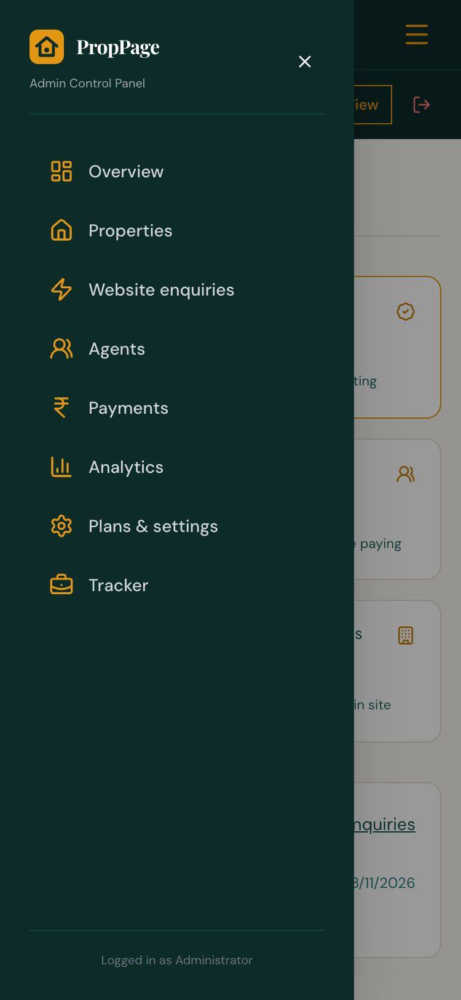

Phone-la mela **☰** (PropPage logo pakkathula, "Web View" irukkura bar-la) tap pannaa admin menu varum: **"Overview"**, **"Properties"**, **"Website enquiries"**, **"Agents"**, **"Payments"**, **"Analytics"**, **"Plans & settings"**, **"Tracker"**. Computer-la idhu left side-la irukkum.

 

## 1. Overview

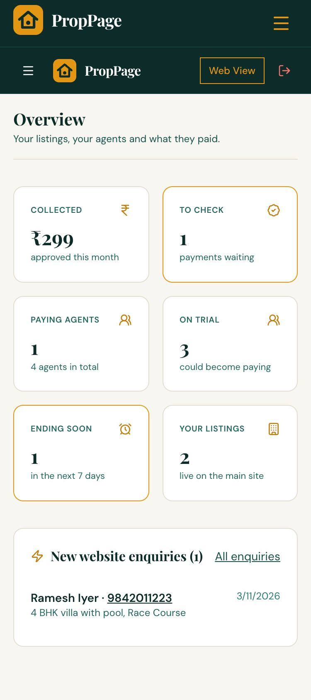

Ore paarvaila business nilamai:

- **"Collected"** — indha maasam approve aana payments.
- **"To check"** — check panna vendiya UPI payments. Tap pannaa Payments.
- **"Paying agents"**, **"On trial"** (pay panna vaaippu irukkuravanga).
- **"Ending soon"** — 7 naal-la plan mudiyura agents.
- **"Your listings"** — main site-la unga sondha listings.
- **"New website enquiries"** — unga listings-ku vandha pudhu enquiries. **"All enquiries"** tap pannaa ellaam.

 

## 2. Properties

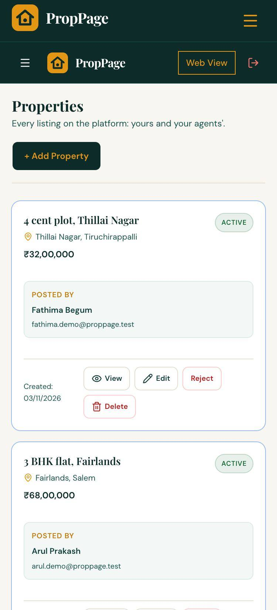

Platform-la irukkura **ellaa listings** — unga sondhamum, agents-oda listings-um.

- **"+ Add Property"** — main PropPage site-la unga sondha listing podunga. Form agent form maadhiri dhaan (speak / paste, photos, private notes). Buyers **"Plans & settings"**-la potta "Your WhatsApp for buyers" number-ku contact pannuvaanga.
- Ovvoru card-la **"Posted by"** — yaar pottadhu.
- **"View"**, **"Edit"**, **"Reject"** (thappaana listing-a maraikka), **"Delete"**.

 

## 3. Website enquiries

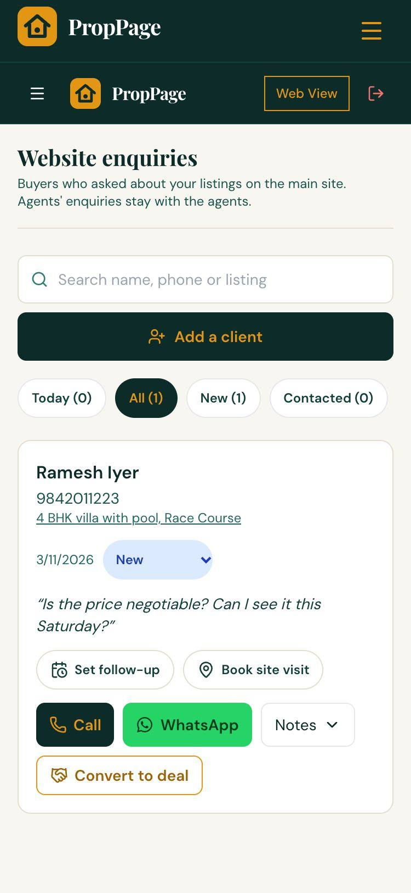

Main site-la **unga listings**-ku vandha enquiries. Agents-oda enquiries agents-kitta dhaan pogum, inga varaadhu.

Agent Enquiries screen maadhiriye: search, **"Add a client"**, filters, status, **"Set follow-up"**, **"Book site visit"**, **"Call"**, **"WhatsApp"**, **"Notes"**.

Admin-ku extra:

- **"Convert to deal"** — indha enquiry-a Tracker-la oru deal-a maathum (buyer, property details-oda). Ore enquiry-ku oru deal dhaan.
- Deal aanadhum **"Open tracker"** button varum.

 

## 4. Agents

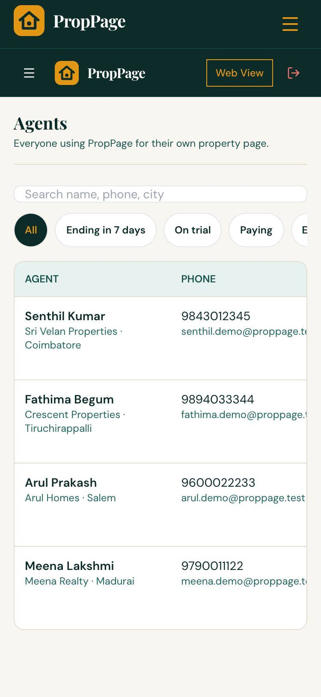

Ellaa agents-um. Search: "Search name, phone, city".

**Filters:** **"All"**, **"Ending in 7 days"**, **"On trial"**, **"Paying"**, **"Ended"**, **"Suspended"**.

Table-la: agent per, agency, ooru, phone, email, plan, mudiyura date, listings (live / mottham). Email confirm pannaadhavangalukku **"Email not confirmed"** nu kaattum.

 

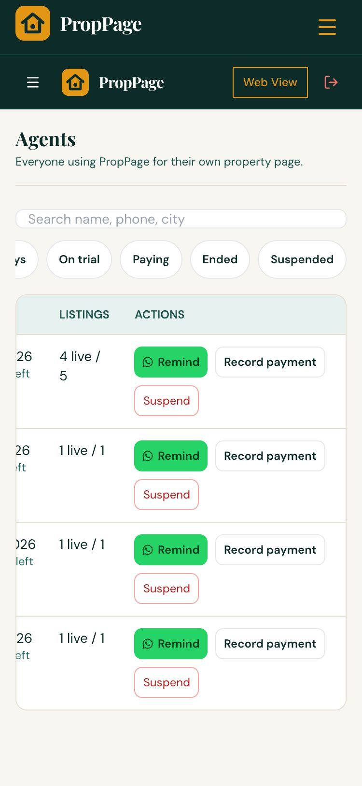

Phone-la **"Actions"** paakka table-a idathu pakkam swipe pannunga.

- **"Remind"** — agent-ku WhatsApp-la renewal nyaabagam (mudiyura date, vilai-oda message ready).
- **"Record payment"** — cash / bank transfer-la vaangina payment-a podunga: **Plan** (Starter / Pro), **Period** (month / year), **"Reference (optional)"**. "Payment recorded. Plan extended." nu varum.
- **"Suspend"** — agent page-a pause pannum ("Agent suspended. Their page is paused."). Thirumba on panna **"Restore"**.

 

## 5. Payments

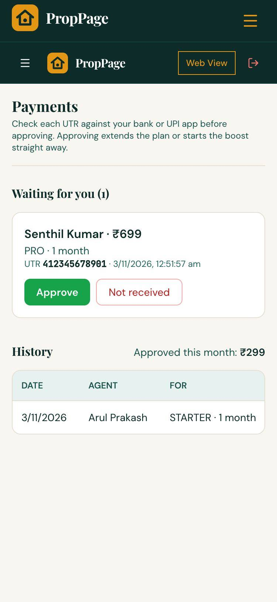

Agents UPI-la pay panni UTR pottadhu ellaam **"Waiting for you"**-la varum: agent, amount, plan / boost, UTR, time.

1. Unga bank app / UPI app-la andha **UTR** number-um amount-um vandhirukkaa nu check pannunga.
2. Vandhirundhaa **"Approve"** tap pannunga. Plan extend aagum (illa boost start aagum). Agent-ku "Payment received — thank you" email pogum.
3. Kedaikkala-na **"Not received"** tap pannunga → **"Reason (sent to agent)"** type pannunga → **"Reject"**. Agent-ku email pogum. Thirumba poga **"Back"**.

Keezha **"History"** — munnaadi approve / reject pannadhu. **"Approved this month"** — indha maasa mottham.

 

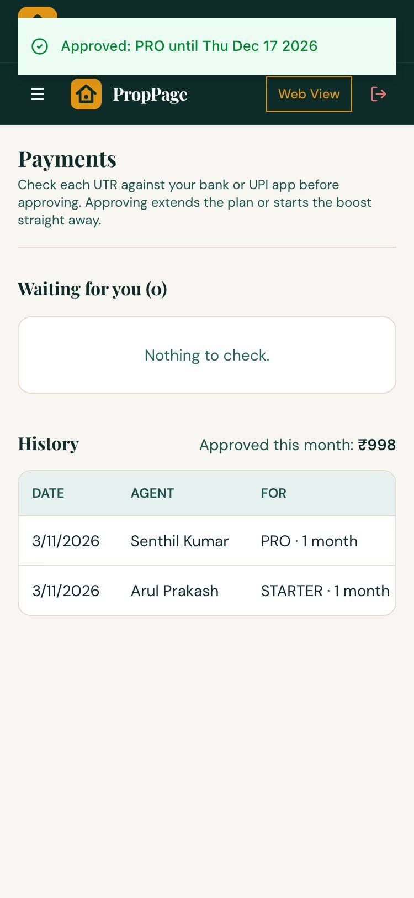

Approve pannadhum "Approved: PRO until …" nu pudhu mudivu date-oda kaattum. Agent seekiram renew pannaa, pudhu naal pazhaya mudivu date-ku mela serum.

 

## 6. Analytics

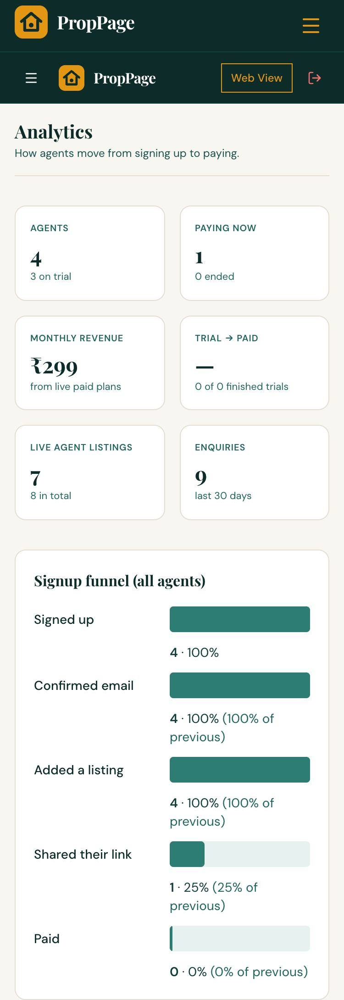

"How agents move from signing up to paying."

- **Tiles:** **"Agents"** (evvalavu per trial-la), **"Paying now"**, **"Monthly revenue"** (live paid plans-la irundhu), **"Trial → paid"**, **"Live agent listings"**, **"Enquiries"** (kadaisi 30 naal).
- **"Signup funnel (all agents)"** — Signed up → Confirmed email → Added a listing → Shared their link → Paid. Endha step-la agents nikkuraanga nu paarunga. Udhaaranam, "Shared their link" kammi-na, agents-ku Share my page pathi sollunga.
- **"Weekly signups (last 8 weeks)"**.
- **"Payments approved, by month"** — plans, boosts, total. GST, expenses Tracker-la.

 

## 7. Plans & settings

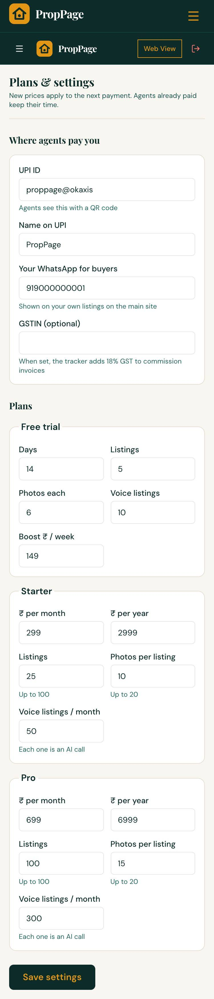

"New prices apply to the next payment. Agents already paid keep their time."

**"Where agents pay you":**

- **"UPI ID"**, **"Name on UPI"** — agents idha QR code-oda paappaanga. Idhu kaali-na agents pay panna mudiyaadhu ("Online payment details are being set up…").
- **"Your WhatsApp for buyers"** — main site-la unga sondha listings-ku buyers contact panna.
- **"GSTIN (optional)"** — pottaa, Tracker commission invoice-la 18% GST serum.

**"Plans":**

- **Free trial** — **Days**, **Listings**, **Photos each**, **Voice listings**, **Boost ₹ / week**.
- **Starter**, **Pro** — **₹ per month**, **₹ per year**, **Listings** (100 varaikkum), **Photos per listing** (20 varaikkum), **Voice listings / month** (ovvonnum oru AI call — selavu irukku).

Maathunadhum **"Save settings"**.

 

## 8. Tracker — unga private back office

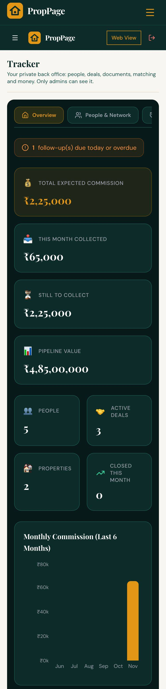

"Your private back office: people, deals, documents, matching and money. Only admins can see it." Agents-ku idhu theriyaadhu.

Mela tabs: **"Overview"**, **"People & Network"**, **"Deals"**, **"Properties"**, **"Buyer Match"**, **"Commission"**, **"Analytics"**, **"Expenses"**. Phone-la tabs-a idathu pakkam swipe pannunga.

**Overview** — inniki follow-ups, **"Total expected commission"**, **"This month collected"**, **"Still to collect"**, **"Pipeline value"**, people / deals / properties count, maasa commission chart, deal types, recent activity.

 

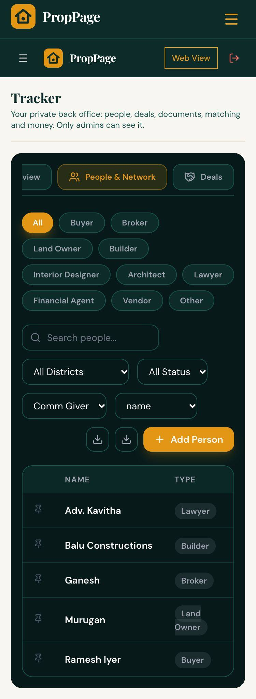

**People & Network** — unga contacts: Buyer, Broker, Land Owner, Builder, Interior Designer, Architect, Lawyer, Financial Agent, Vendor, Other.

- **"+ Add Person"** — peyar, mobile, district, area, company, RERA ID, commission tharuvaangala (commission giver), rate, notes. Buyer-na budget, property type.
- Type, district, status filters; search; CSV download.

 

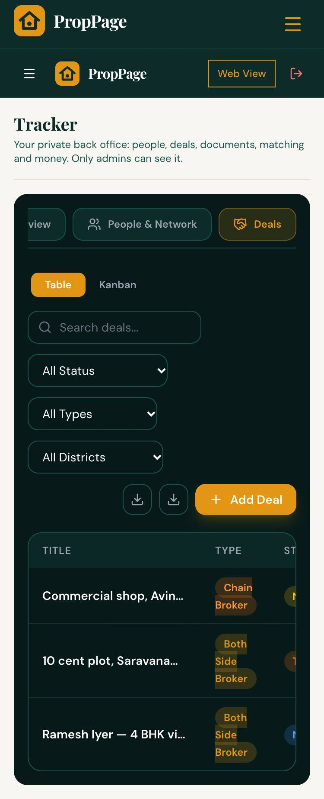

**Deals** — ovvoru deal-um:

- **"+ Add Deal"** — title, deal type (Both Side Broker, Buyer Side Only, Seller Side Only, Direct Deal, Chain Broker, Referral), property, value, seller, buyer, brokers, commission % (seller side / buyer side), token amount, follow-up date, notes, documents.
- Status: New Lead → Site Visit Done → Negotiation → Token Paid → Agreement Signed → Registration Done → Completed (illa Dropped).
- **"Table"** illa **"Kanban"** view. Website enquiry-la **"Convert to deal"** pannadhum inga varum.

 

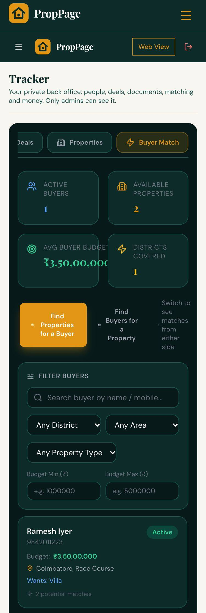

**Properties** — tracker-la unga deal properties, title documents checklist-oda.

**Buyer Match** — **"Find Properties for a Buyer"** illa **"Find Buyers for a Property"**. Buyer-a select pannaa budget, district, type-ku match aagura properties kaattum.

 

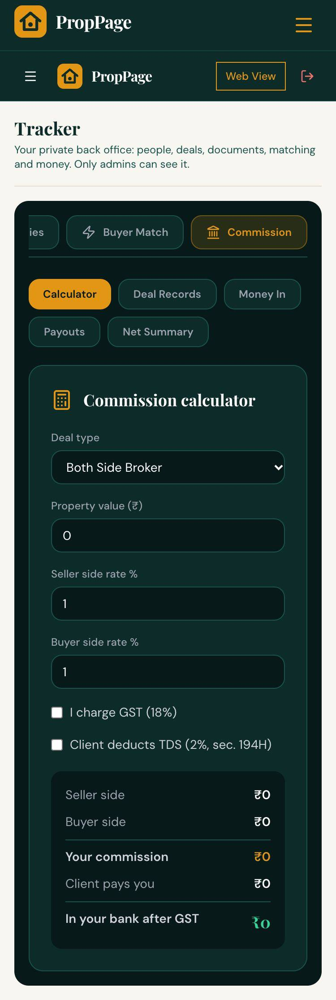

**Commission** — **"Calculator"** (deal type, value, seller / buyer rate, GST 18%, TDS 2% sec. 194H — "In your bank after GST"), **"Deal Records"**, **"Money In"** (vaangina commission), **"Payouts"** (matha brokers-ku kuduthadhu), **"Net Summary"**.

**Analytics** — deals, commission charts.

 

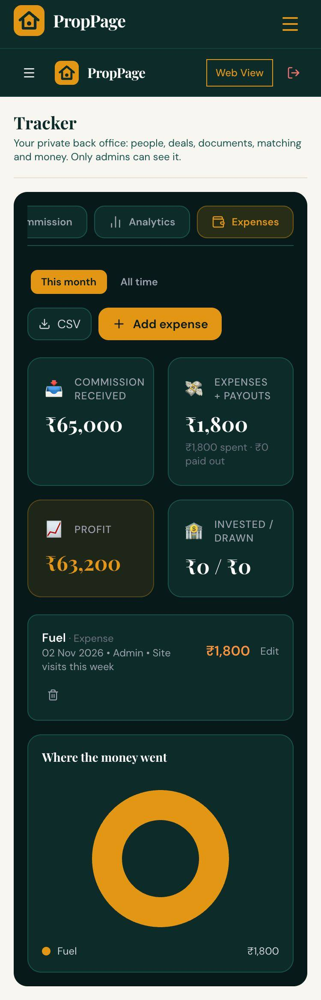

**Expenses** — **"+ Add expense"**: petrol, office, ads… **"This month"** / **"All time"**, commission received vs expenses, profit, **CSV** download.

 

## 9. Daily admin velai — checklist

1. **Payments** — "To check" irundhaa UTR check panni Approve / Not received.
2. **Website enquiries** — pudhu enquiries-ku call / WhatsApp, follow-up podunga.
3. **Agents** → **"Ending in 7 days"** — **"Remind"** WhatsApp anuppunga.
4. **Tracker** → Overview — inniki follow-ups.
5. Vaaram oru dhadava **Analytics** — signup funnel paarunga.
